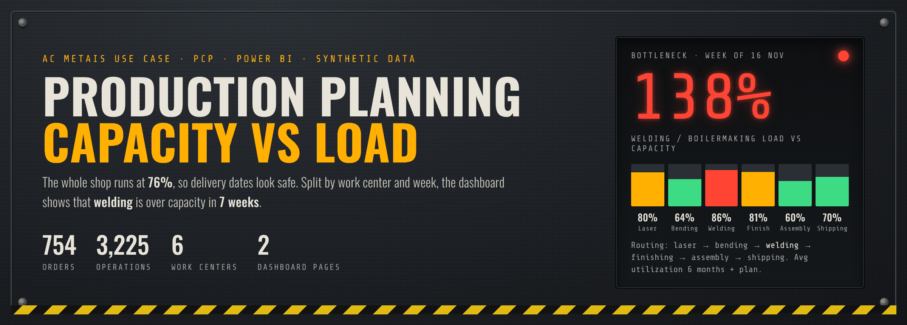
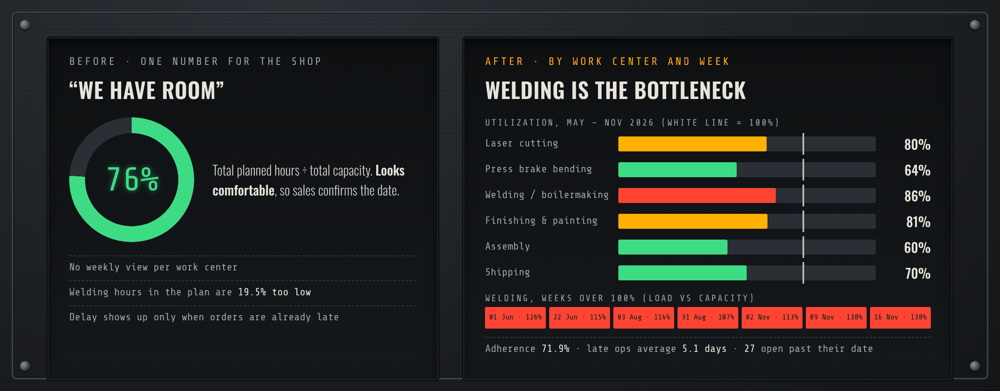
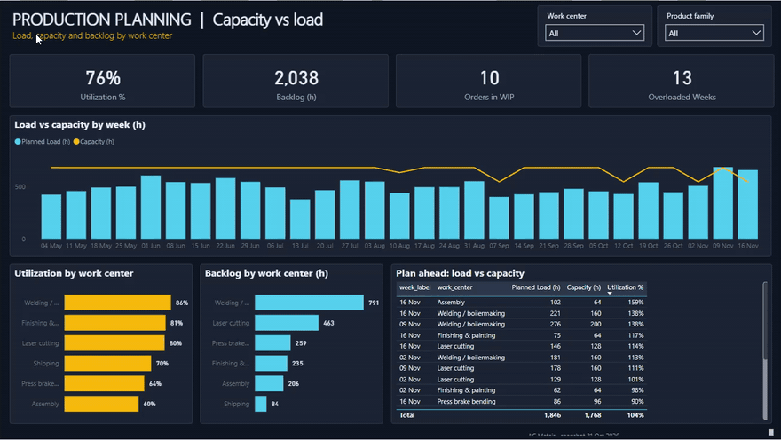
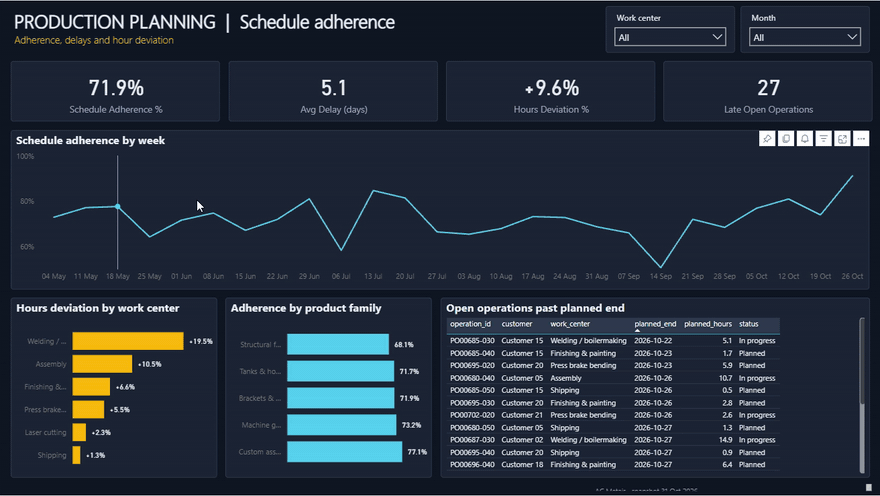
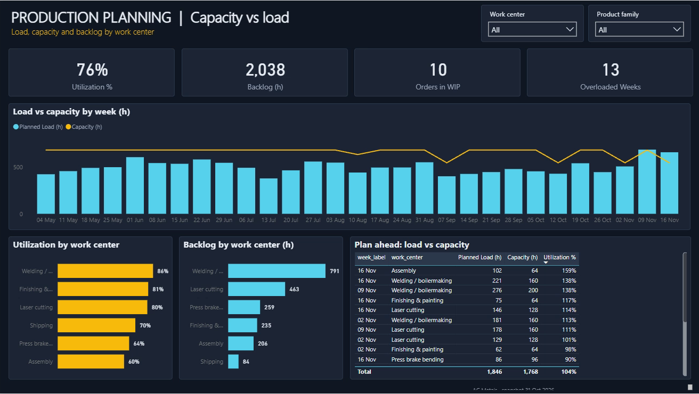
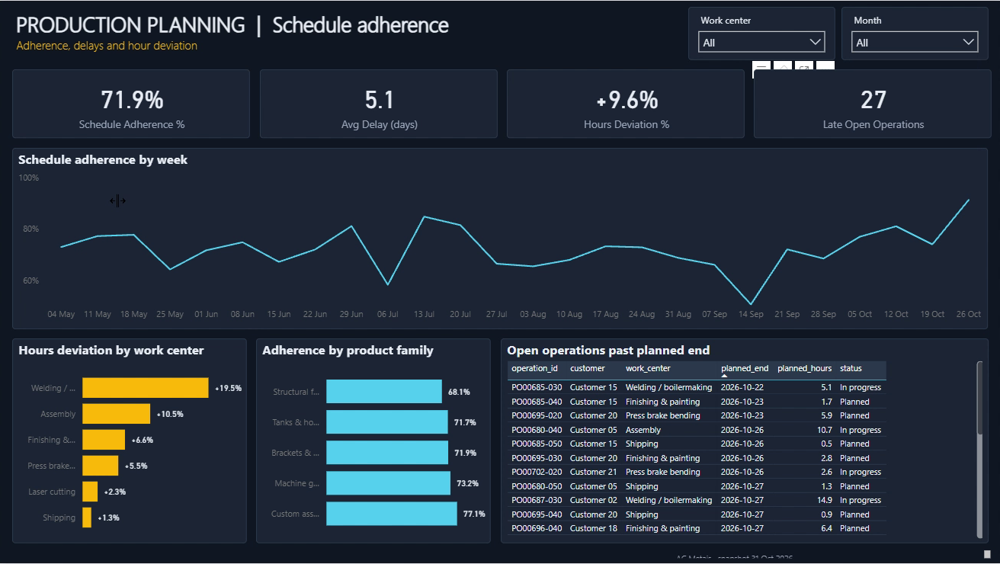
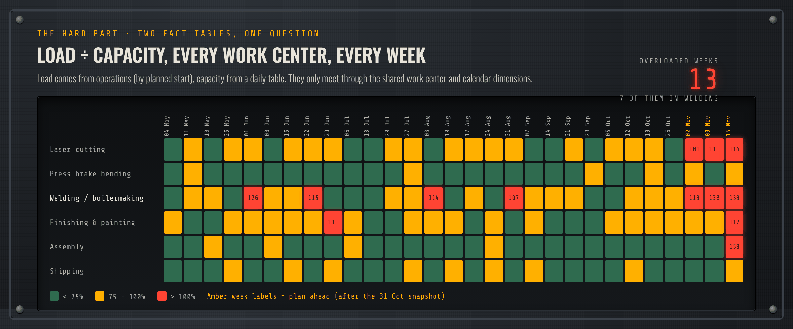

# Production Planning · Capacity vs Load



A Power BI dashboard for production planning (PCP) in a metal fabrication shop. It compares the planned load of each work center with its capacity, week by week.

| | |
|---|---|
| **Problem** | Sales confirmed delivery dates looking at the total workload of the shop. The total looked fine, but one work center was overloaded, so orders were late. |
| **Solution** | A dashboard that shows load vs capacity by work center and by week, and how well the plan is being followed. |
| **Result** | The shop runs at 76% overall, but welding is over 100% in 7 weeks (peak 138%). The team can plan overtime before orders are late. |
| **Tools** | Power BI · DAX · Power Query · Excel |
| **Context** | I worked with BI at AC Metais, a Brazilian laser cutting and metal fabrication company. This dashboard rebuilds a planning case from that shop with synthetic data. |

---

## The problem



Every order follows the same route: laser cutting → bending → welding → finishing → assembly → shipping. Sales looked at the total workload of the shop to promise delivery dates. The total looked comfortable, but the hours were not spread evenly: welding was overloaded, and every order that went through it was late.

## The dashboard

Two pages, published in the Power BI Service. Filters and cross-filtering work on both.

**Capacity vs load.** Can the shop deliver the plan, and where is the bottleneck? Load vs capacity by week, utilization and backlog by work center, and a table of the next weeks showing which work centers need overtime.



**Schedule adherence.** Are we following the plan? Adherence by week, actual vs planned hours by work center, adherence by product family and the list of late operations.



<details>
<summary><b>Full-size screenshots</b></summary>





</details>

## Results



Synthetic data, snapshot on 31 Oct 2026:

| | |
|---|---|
| Orders / operations | 754 / 3,225 |
| Utilization, whole shop | 76% |
| Utilization, welding | 86% on average, over 100% in 7 weeks, peak 138% |
| Welding hours, actual vs planned | +19.5% (the largest deviation) |
| Schedule adherence | 71.9% of operations finish on time |
| Backlog | 2,038 planned hours |

**Decisions it supports:** plan overtime or a temporary welder for November, review the welding time standards, and check welding capacity before confirming large orders.

## Files

```
data/production_planning.xlsx    synthetic data
powerbi/ProductionPlanning.pbip  the Power BI report
docs/                            images
```

To open it in Power BI Desktop:

1. Open `powerbi/ProductionPlanning.pbip`.
2. *Transform data → Edit parameters →* set **DataFolder** to the full path of the `data` folder, ending with `\`.
3. *Refresh.*

## How this was built

The problem and the business rules come from my BI work at AC Metais. The data is synthetic; nothing comes from the company. I used an AI assistant to help build the report faster and reviewed the result.

---

Lucas Fernandes Nunes · [Portfolio](https://lucasnunesf.notion.site/Lucas-Nunes-Data-BI-Analyst-3de917c89c178092885cf639b619767b) · [GitHub](https://github.com/lucasnunesf)
