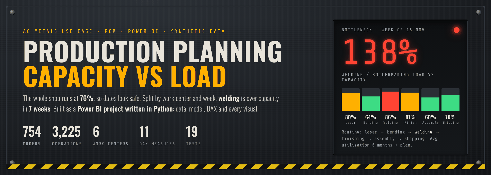
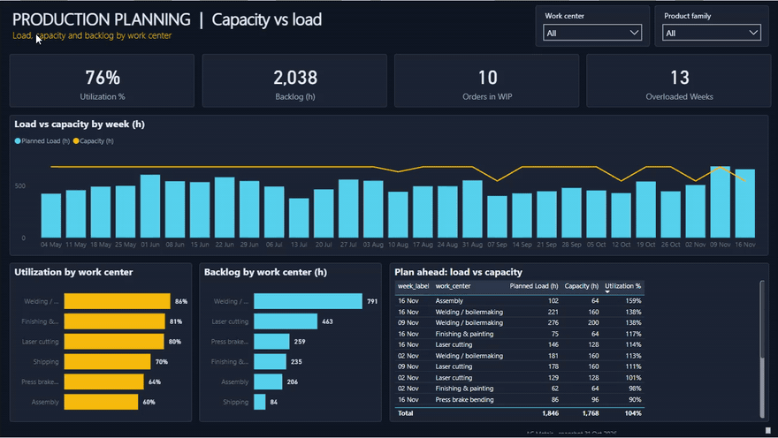
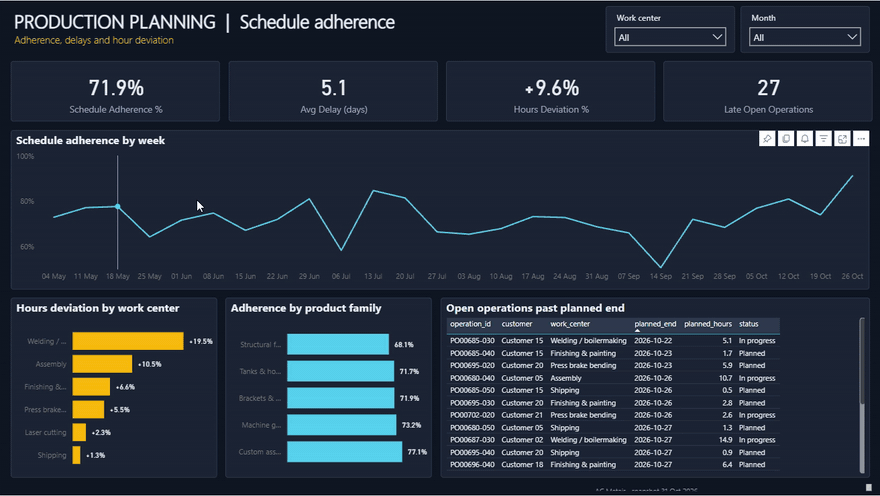
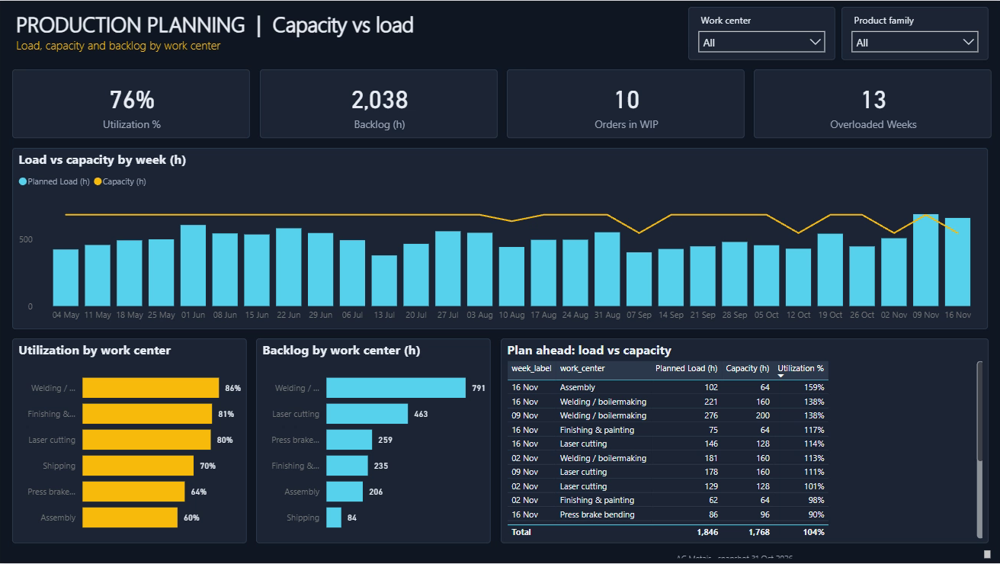
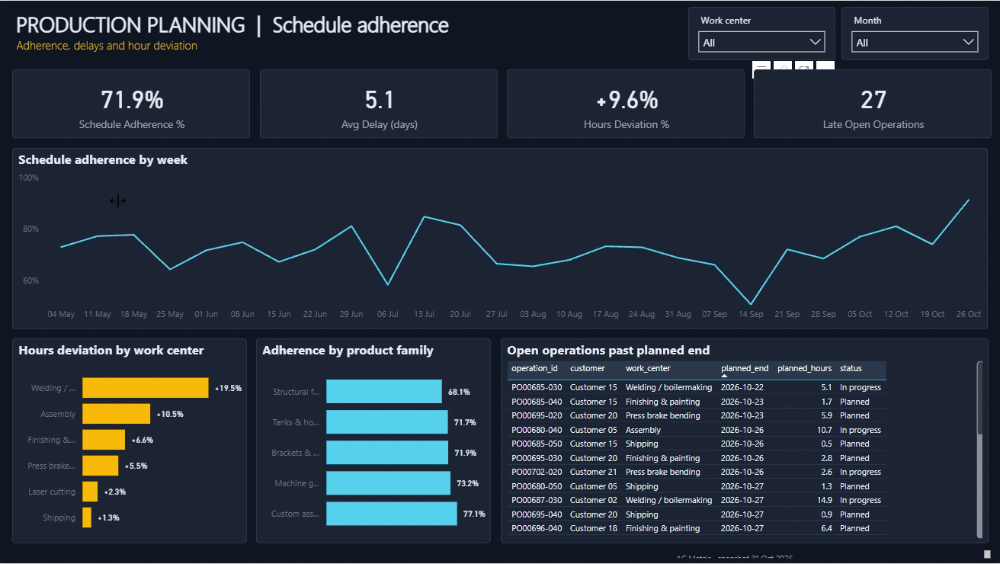
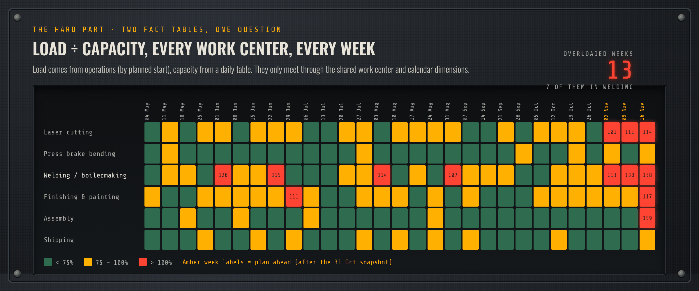
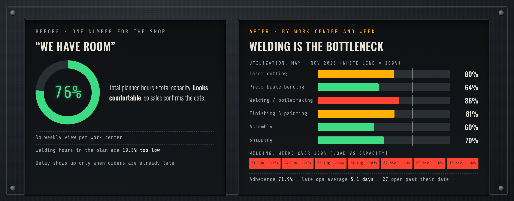
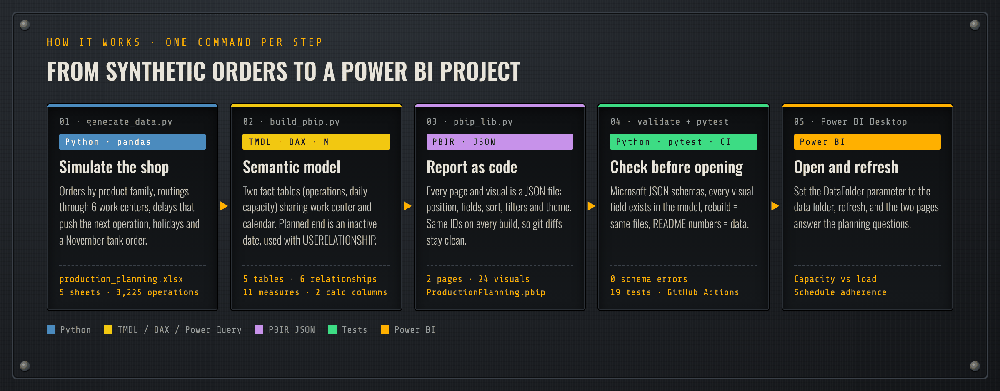

# Production Planning · Capacity vs Load

A Power BI dashboard for production planning (PCP) in a metal fabrication shop. It compares the planned load of each work center with its capacity, week by week, and shows that the shop looks fine in total while welding is the bottleneck.




[](https://github.com/lucasnunesf/production-planning-dashboard/actions/workflows/tests.yml)

| At a glance | |
|---|---|
| **Result** | The shop runs at 76% overall, but welding averages 86%, goes over 100% in 7 weeks and reaches 138% in November. Welding also takes 19.5% more hours than planned. |
| **My role** | I worked with BI at AC Metais, a Brazilian laser cutting and metal fabrication company. This repository rebuilds a planning use case from that shop with synthetic data: data generator, data model, DAX, report pages, tests. |
| **What's here** | A Power BI project (`.pbip`) written by Python and published to the Power BI Service: 5 tables, 11 DAX measures, 2 pages, 24 visuals. A data generator, a pandas check of the numbers, 19 automated tests, CI on every commit. |
| **Skills** | Power BI, DAX, Power Query (M), data modelling (galaxy schema, role-playing dates), TMDL / PBIR, Python (pandas), pytest, GitHub Actions |
| **Full case** | [docs/case-study.md](docs/case-study.md) |

All data is synthetic. Nothing here comes from the company.

---

## The dashboard

Recorded in the Power BI Service after publishing the project. Slicers and cross-filtering work on both pages.

**Capacity vs load.** Can the shop deliver the plan, and where is the bottleneck? Picking a work center or a product family updates the weekly load against capacity, and the table shows which work centers need overtime in the coming weeks.



**Schedule adherence.** Are we following the plan, and where do the hours go? Adherence by week, hours deviation by work center, adherence by product family and the open operations already past their planned end.



<details>
<summary><b>Full-size screenshots</b></summary>





</details>

---

## Results



Numbers from the dataset, snapshot on 31 Oct 2026, plan until 22 Nov 2026:

| | |
|---|---|
| Orders / routing operations | 754 / 3,225 |
| Utilization, whole shop | 76% |
| Utilization, welding | 86% on average, over 100% in 7 weeks, peak 138% |
| Welding hours, actual vs planned | +19.5% (the largest deviation of all work centers) |
| Schedule adherence | 71.9% of operations finish by their planned end |
| Average delay of late operations | 5.1 days |
| Backlog | 2,038 planned hours, 27 operations open past their planned end |

Decisions it supports: plan overtime or a temporary welder for November, fix the welding time standards, and check welding capacity before confirming large tank orders.

---

## The problem



Every order follows a routing: laser cutting → press brake bending → welding → finishing → assembly → shipping. Sales confirmed delivery dates looking at the total workload of the shop. The total looked comfortable, but the hours were not spread evenly: one work center was overloaded, and every order that went through it was late.

The dashboard answers two questions, one per page:

- **Capacity vs load.** Can the shop deliver the plan, and where is the bottleneck? KPI cards (utilization, backlog hours, orders in WIP, overloaded weeks), load vs capacity by week, utilization and backlog by work center, and a table of the next weeks showing which work centers need overtime.
- **Schedule adherence.** Are we following the plan, and where do the hours go? KPI cards (adherence, average delay, hours deviation, late open operations), adherence by week, actual vs planned hours by work center, adherence by product family and the list of late open operations.

---

## How it works



| Step | What it does | Language | Output |
|---|---|---|---|
| `scripts/generate_data.py` | Creates orders, routings, delays, holidays and a large tank order in November. Seeded, so it always gives the same data. | Python | `data/production_planning.xlsx` |
| `scripts/build_pbip.py` | Describes the dashboard: tables, Power Query, relationships, DAX measures, pages and visuals. | Python | `powerbi/ProductionPlanning.pbip` |
| `scripts/pbip_lib.py` | Small reusable builder that writes the model in TMDL and the report in PBIR (one JSON file per page and visual). | Python | TMDL + PBIR files |
| `scripts/validate_pbir.py` | Checks every report file against Microsoft's JSON schemas. | Python | `0 schema errors` |
| `scripts/kpi_snapshot.py` | Computes the main numbers with pandas, using the same logic as the DAX, so they can be checked without Power BI. | Python | numbers in the terminal |

### Data model

Two fact tables that share dimensions (galaxy schema), filters in one direction.

```
                dOrder        dWorkCenter
                  │ 1          1 │    │ 1
                  │              │    │
 fOperations * ───┘──────────── *┘    └──── * fCapacity
     * │ ┄┄┄ * (planned_end, inactive)          * │
       │ 1                                      │ 1
   dCalendar ───────────────────────────────────┘
   (planned_start)                          (date)
```

| Table | Grain | Rows |
|---|---|---|
| `fOperations` | one routing operation of an order | 3,225 |
| `fCapacity` | work center × working day (hours available) | 870 |
| `dOrder` | production order | 754 |
| `dWorkCenter` | work center | 6 |
| `dCalendar` | day, with week and horizon (history / plan ahead) | 203 |

## Design decisions

- **Two fact tables, not one.** Load lives at the operation level and capacity at the day × work center level. Putting capacity on the operations table would repeat it or lose days with no work. They meet through the shared work center and calendar dimensions.
- **Planned end as an inactive relationship.** Load is counted by planned start. Adherence and delay need planned end, so that relationship is inactive and switched on with `USERELATIONSHIP` only inside those measures. The model stays a simple star.
- **Overloaded weeks counted per work center.** A total utilization number hides the bottleneck, so the measure counts work center × week combinations above 100%:

```DAX
Overloaded Weeks =
SUMX (
    VALUES ( dWorkCenter[work_center] ),
    COUNTROWS ( FILTER ( VALUES ( dCalendar[week_start] ), [Utilization %] > 1 ) )
)
```

- **Report as code.** The `.pbip` format is plain text, so the model and every visual can be reviewed in a pull request and rebuilt with one command. IDs are deterministic, so rebuilding does not create noisy diffs.

---

## Try it

```bash
pip install -r requirements.txt
python scripts/generate_data.py
python scripts/build_pbip.py
python scripts/kpi_snapshot.py
```

Output:

```
3,225 operations / 754 orders written to .../data/production_planning.xlsx
Built .../powerbi/ProductionPlanning.pbip: 5 tables, 11 measures, 2 pages, 24 visuals

Operations / orders        3,225 / 754
Utilization (all)          76%
Welding utilization        86%  (> 100% in 7 weeks, peak 138%)
Welding hours vs plan      +19.5%
Schedule adherence         71.9%  (late ones: 5.1 days)
Backlog                    2,038 h
Late open operations       27
Orders in WIP              10
```

Then, on Windows:

1. Open `powerbi/ProductionPlanning.pbip` in Power BI Desktop.
2. *Transform data → Edit parameters →* set **DataFolder** to the full path of the `data` folder, ending with `\`.
3. *Refresh.*

## Tests

```bash
git clone --depth 1 https://github.com/microsoft/json-schemas.git   # optional, for the schema test
pytest
```

```
============================== 19 passed in 3.50s ==============================
```

| File | What it checks |
|---|---|
| `tests/test_data.py` | The generator gives the same file every time. Keys match. Routings follow the work center order. Planned dates fall on working days. Status matches actual hours and dates. Holidays have no capacity. |
| `tests/test_model.py` | Rebuilding gives exactly the files in the repository. Every column and measure used by a visual or a DAX formula exists in the model (the JSON schemas don't check this). A broken visual is caught. All report files pass Microsoft's schemas. |
| `tests/test_kpis.py` | Every number in this README is recomputed from the data, including the bottleneck and the 13 overloaded work center weeks. |

GitHub Actions runs the tests on every commit.

<details>
<summary><b>Project layout</b></summary>

```
data/production_planning.xlsx      synthetic data (5 sheets)
scripts/generate_data.py           data generator (seeded)
scripts/pbip_lib.py                reusable TMDL + PBIR builder
scripts/build_pbip.py              dashboard definition
scripts/validate_pbir.py           schema validation
scripts/kpi_snapshot.py            main numbers with pandas
powerbi/ProductionPlanning.pbip    open this in Power BI Desktop
tests/                             data, model and number tests
docs/                              case study and README images
```

</details>

<details>
<summary><b>Glossary</b></summary>

- **PCP**: production planning and control (*planejamento e controle da produção*).
- **Work center**: a group of machines or people that does one kind of operation, like welding.
- **Routing**: the ordered list of work centers an order goes through.
- **Load**: planned hours of the operations that start in a period.
- **Capacity**: hours a work center has available in a period.
- **Utilization**: load ÷ capacity. Above 100% means the plan does not fit.
- **Schedule adherence**: share of finished operations that ended on or before the planned end.
- **Backlog**: planned hours not finished yet.

</details>

---

## Next steps

- Read orders and routings from the ERP instead of the generator.
- Add a what-if parameter for overtime hours per work center.
- Keep a weekly snapshot of the plan, to compare what was promised with what happened.

## How this was built

The problem, the business rules and the design decisions are mine. They come from my BI work at AC Metais. I used an AI coding assistant to write the code faster and reviewed the result.


## Author

Lucas Fernandes Nunes · [Portfolio](https://lucasnunesf.notion.site) · [GitHub](https://github.com/lucasnunesf)
